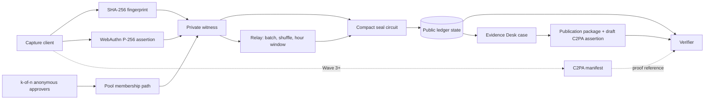

# Unforged — Architecture

## System objective

Unforged proves that a digital asset was approved by one credential in an authorized organizational pool without disclosing which credential. The architecture separates four kinds of evidence:

1. **Asset binding:** which exact bytes or provenance manifest are being discussed.
2. **Private authorization:** whether an eligible credential approved them.
3. **Capture assurance:** what hardware, application and sensor evidence exists.
4. **Editorial judgment:** context, scene truth and publication decisions.

Only the first two are implemented in the Wave 2 browser foundation. Capture assurance and operational editorial workflow are release-gated.

## System overview

## Wave 2 execution path

1. The browser initializes generated Compact code in `compact-runtime`.
2. Enrollment creates a P-256 credential and a random salt.
3. The client computes `H("unforged:device:v1", pk.x, pk.y, salt)`.
4. The private admin witness authorizes insertion of the commitment into the pool tree.
5. Capture produces image bytes and computes SHA-256 locally.
6. WebAuthn signs a challenge bound to the contract and fingerprint.
7. Private witness code supplies key, salt, path, signature and authenticator data.
8. The circuit verifies membership, signature, RP/origin, user flags, time, uniqueness and pool size.
9. The ledger records the disclosed seal fields.
10. Verification recomputes the file fingerprint and reads the local ledger state.

No media bytes are sent to the contract. Reloading the browser resets the Wave 2 evaluation pool.

## Contract: `unforged.compact`

Toolchain: Compact **0.35.0**, `--feature-zkir-v3`, ledger 9, runtime **0.20.0**.

### Public ledger state

| Field | Type | Purpose |
|---|---|---|
| `admin` | `Bytes<32>` | Domain-separated commitment to the private admin secret |
| `rpIdHash` | `Bytes<32>` | WebAuthn relying-party binding |
| `devices` | `HistoricMerkleTree<16, Bytes<32>>` | Opaque credential commitments; capacity 65,536 |
| `deviceCount` | `Counter` | Current pool size used by the anonymity-floor check |
| `seals` | `Map<Bytes<32>, Seal>` | Fingerprint to seal time and epoch |
| `epoch` | `Counter` | Revocation generation; incremented when accepted history resets |
| `approvers` | `MerkleTree<4, Bytes<32>>` | Opaque approver commitments (up to 16) |
| `approvalThreshold` | `Uint<8>` | k approvals required to enroll; 0 lets the owner enroll directly |
| `approvals` | `Map<Bytes<32>, Uint<8>>` | Pending credential commitment to approval tally |
| `nullifiers` | `Set<Bytes<32>>` | Spent (approver, credential) approval nullifiers |

### Private state and witnesses

| Value | Holder | Why private |
|---|---|---|
| Admin secret | Pool owner witness | Registers approvers and revokes credentials |
| Approver secret and path | Each approver's witness | Disclosure would show which approvers approved a credential |
| P-256 secret/public key | Authenticator and client witness | Publishing the key would create a contributor activity graph |
| Device salt | Client witness | Prevents commitment guessing and cross-pool correlation |
| Merkle path and index | Client witness | Would identify the enrolled commitment used for a seal |
| Signature and authenticator data | Client witness | Can contain credential-correlating material |
| Contributor identity | Enrollment system, outside contract | The public contract does not need it |

### Circuits

| Circuit | Private authorization | Public behavior | Refusals |
|---|---|---|---|
| `enroll` | Admin secret | Inserts an opaque device commitment when the pool has no threshold | `NOT_ADMIN`, `APPROVAL_REQUIRED`, `POOL_FULL` |
| `addApprover` | Admin secret | Inserts an opaque approver commitment | `NOT_ADMIN`, `APPROVERS_FULL` |
| `approve` | Approver secret and approver path | Proves approver membership, spends a nullifier, tallies; the k-th approval enrolls the credential | `NOT_APPROVER`, `ALREADY_APPROVED`, `NO_APPROVAL_POLICY`, `POOL_FULL` |
| `revoke` | Admin secret | Removes a leaf, increments epoch and resets accepted history | `NOT_ADMIN`, floor/index guards |
| `seal` | Credential key, salt, path, assertion and authenticator data | Records a unique fingerprint, time and epoch | `NOT_ENROLLED`, `BAD_SIGNATURE`, `ALREADY_SEALED`, `POOL_TOO_SMALL`, `BAD_TIME` plus WebAuthn profile guards |

P-256 verification uses `secp256r1EcdsaVerify` and a WebAuthn profile adapted from Midnight Passport. Structs containing `Secp256r1Point` remain internal because Compact 0.35 exported-struct TypeScript generation does not unify that curve type correctly.

## Privacy boundary

Every Compact `disclose()` must correspond to this table.

| Value | Public | Reason | Privacy consequence |
|---|:---:|---|---|
| Admin commitment | Yes | Contract must verify admin witness | Does not expose the secret |
| RP ID hash | Yes | Establishes WebAuthn relying party | Identifies the service origin, not a contributor |
| Credential commitment | Yes | Required for pool membership | Random salt prevents public-key guessing |
| Pool size | Yes | Supports anonymity-floor policy and verifier context | Small pools weaken anonymity and are blocked below the floor |
| Pool epoch | Yes | Communicates revocation generation | Reveals that pool membership changed, not which signer sealed |
| Fingerprint | Yes | Binds the public record to exact bytes | Anyone holding candidate media can test for a match |
| Stated seal time/window | Yes | Supports freshness checks | Timing can aid correlation; relay and coarse windows are production controls |
| Approval threshold | Yes | Verifiers and members must know the enrollment policy | Policy is public; approvers are not |
| Approver commitment | Yes | Approver membership tree | Does not expose the approver secret or identity |
| Approval nullifier | Yes | Prevents one approver counting twice | Unique per (approver, credential); unlinkable across credentials and to the approver commitment |
| Pending approval tally | Yes | Enrollment completes on the k-th approval | Shows how many approvals a commitment has, never which approvers |
| Merkle root of approver path | Yes | `checkRoot` against the approver tree | Shared by every approver; does not identify one |
| Approver secret and path | No | Approval witness | Disclosure identifies the approver |
| Credential public key | No | Unnecessary for public verification | Would link all records from one credential |
| Salt | No | Commitment-hiding input | Disclosure permits commitment recomputation |
| Merkle path/index | No | Membership witness | Disclosure identifies the credential position |
| WebAuthn signature/auth data | No | Signature witness | May reveal credential and authenticator properties |
| Contributor identity/location/device metadata | No | Outside the proof requirement | High physical and organizational risk |

## Domain separation

Every cryptographic hash has a 32-byte padded domain separator:

- `unforged:admin:v1`
- `unforged:device:v1`
- `unforged:seal:v1`
- `unforged:approver:v1`
- `unforged:approval:v1`

The seal challenge includes contract context and the file fingerprint so an assertion cannot be moved between pools or files.

## Off-chain components

| Component | Current | Production direction |
|---|---|---|
| Capture | Browser camera or generated test frame | Native iOS/Android and camera SDK with hardware and application attestation |
| Credential | WebAuthn passkey or labeled software signer | Device-bound hardware credential with attestation and recovery policy |
| Provenance | Exact SHA-256 file binding | C2PA manifest, hard binding, soft-binding recovery and edit history |
| Proving | Browser local simulator | Pool-controlled/self-hosted proof service, then on-device proving when feasible |
| Submission | Local relay in the browser: batches of three, shuffled order, capture time published to the hour | Independent relays receiving finished proofs over an anonymizing transport, timer-closed batches, jitter and no source-linked logs |
| Storage | Browser memory; Evidence Desk cases with checklist, decision log and publication package | Encrypted organization-controlled evidence cases with roles and retention policy |
| Verification | Local ledger lookup; eight-row security report; offline CLI (`tools/unforged-verify.mjs`) for the draft assertion | Independent indexer, public verifier, API, CMS SDK |
| Administration | 2-of-3 anonymous approver threshold for enrollment; single owner key registers approvers and revokes | Threshold revocation and approver rotation, roles, recovery and audit trail |
| Fees | None in local simulation | Pool-sponsored DUST; contributors never manage tokens |

## C2PA bridge direction

Unforged uses C2PA as the interoperable provenance container and Midnight as the private authorization layer.

The bridge must:

1. validate the incoming C2PA manifest and capture credential;
2. bind a Midnight proof reference to the same asset or manifest;
3. preserve edit and ingredient history;
4. express the achieved assurance level;
5. avoid copying contributor-identifying assertions into the public output;
6. support external manifests and soft-binding recovery after metadata stripping;
7. remain verifiable without calling a proprietary Unforged API.

The precise custom assertion or reference profile requires standards review before implementation.

## Assurance ladder

| Level | Evidence | Current status |
|---|---|---|
| L0 | Software test key | Implemented for no-camera evaluation |
| L1 | WebAuthn approval with UP+UV | Implemented |
| L2 | Device-bound hardware key | Planned native capture gate |
| L3 | Verified application and hardware attestation | Planned commercial pilot gate |
| L4 | Trusted C2PA capture credential | Planned C2PA bridge |
| L5 | Sensor evidence, trusted time and controlled edit chain | OEM/partner integration |

Verifiers display the achieved level; they never treat all seals as equivalent.

## Reliability architecture

Production requires idempotent submission by fingerprint, encrypted offline queues, retry-safe relay jobs, durable stage transitions, multi-region indexer reads, backup and recovery, privacy-preserving observability and incident procedures. Wave 3 must measure proof duration, failure rate, queue age and verification latency before any production claim.

## Toolchain and deployment constraints

- Compact compilation runs on Linux/macOS; CI compiles on Node 24 and uploads generated code for Windows development.
- P-256 verifier keys are approximately 220–290 MB per circuit; simulator compiles use `--skip-zk` where appropriate.
- P-256 requires ZKIR v3 and ledger 9. Public deployment waits for compatible infrastructure; a local ledger-9 network is the fallback.
- `compact-runtime` and Midnight JS must share compatible `onchain-runtime` versions; root overrides prevent duplicate-class failures.
- Block time is expressed in seconds.

## Architecture decisions

| Decision | Reason |
|---|---|
| Anonymous Merkle membership | A public device list would defeat signer privacy |
| Exact bytes in Wave 2 | Gives a testable integrity primitive without overstating edit tolerance |
| C2PA compatibility in production | Preserves global provenance interoperability |
| Explicit assurance levels | Browser approval and hardware capture provide different evidence |
| Revocation resets accepted roots | A removed credential must not use historic membership for future seals |
| Pool-sponsored fees | Contributors should never handle wallets, tokens or seed phrases |
| No per-device activity console | Administrative convenience must not create a source activity graph |
| Public verifier independent of media storage | Anyone should be able to verify without granting Unforged access to the asset |
